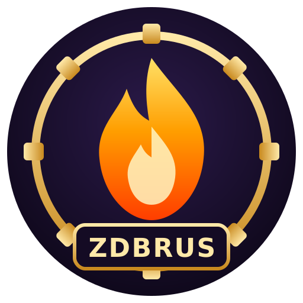
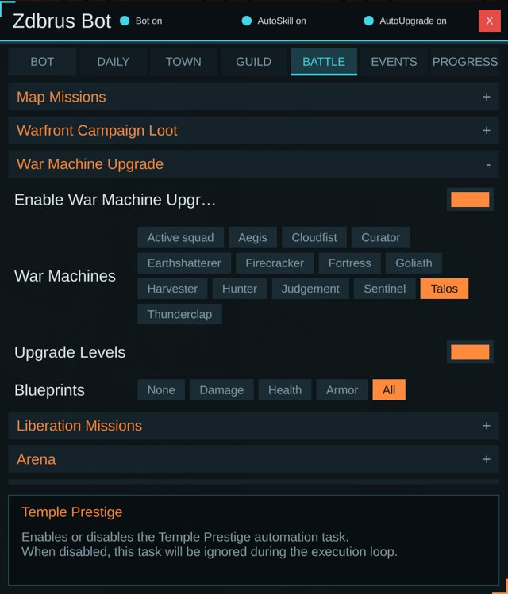
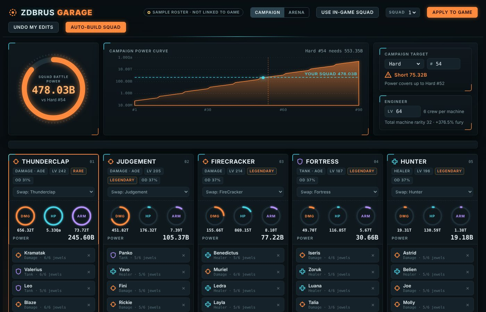



# Zdbrus Bot

### Free auto-play bot for **Firestone: Idle Clicker Online RPG** (Steam / Epic)

Runs inside the game as a MelonLoader mod. No pixel clicking, so screen size and resolution never matter.

**[Website](https://zdbrus.github.io/zdbrus-bot/)** · **[Discord](https://discord.gg/U4APWwTa7F)** · **[Install guide](#install-in-4-steps)** · **[Features](#what-it-does)** · **[FAQ](#faq)** · **[Report a bug](https://github.com/zdbrus/zdbrus-bot/issues/new/choose)**

---

> **Already have the bot?** Version 0.7.36 and later can update automatically when **F1 > General >
> Auto Update** is on. Close the game, wait for the updater to finish, then reopen. If automatic updates
> are off or fail, replace `Mods\ZdbrusBot.dll` with the one from the
> [latest release](https://github.com/zdbrus/zdbrus-bot/releases/latest) while the game is closed.

## Install in 4 steps

1. **Install stable MelonLoader 0.7.3** on Firestone using the official installer: [MelonLoader releases](https://github.com/LavaGang/MelonLoader/releases/latest). Point it at `Firestone.exe`. Do not use a nightly build; newer nightlies crash the game.
   (Steam: right-click Firestone > Manage > Browse local files to find the folder.)
2. **Start the game once and close it.** MelonLoader finishes setting itself up on the first run.
3. **Download [ZdbrusBot.zip](https://github.com/zdbrus/zdbrus-bot/releases/latest/download/ZdbrusBot.zip)** and extract all of it into the Firestone folder (the one with `Firestone.exe`), replacing files when asked. It contains `Mods\ZdbrusBot.dll` plus three fixed MelonLoader files (`MelonLoader\net6\Il2CppInterop.*.dll`) that the current game needs.
4. **Start the game.** The bot starts by itself (Auto Start). Press **F1** to pick which features to turn on, and **F7** to stop or start it.

**Want all task switches on at every launch?** Turn on **F1 > General > Enable All On Launch**
(off by default). At the next fresh game launch it enables Bot Auto Start, AutoUpgrade, AutoSkill and
every task's Enable switch. It leaves priorities, reserves, combos and optional spending settings alone.
Anything you manually turn off stays off for that game process, including account switches; restarting
the game turns those switches back on. Check your prestige and spending settings before opting in.

AutoUpgrade and AutoSkill resume with fresh workers when the gameplay scene reloads. F6/F8 and their
F1 Enable switches now control the same state. A worker error disables its switch and logs the reason;
enable it once in F1 or press its hotkey to retry. An empty skill combo cannot start.

> Coming from Firebot? Delete `Mods\firebot.dll` so only one bot runs. Your old settings are moved over automatically.
>
> The download includes three fixed `Il2CppInterop` files the current game needs. Keep them installed; without them the game can close during startup. Auto Update uses separate PowerShell helpers to check GitHub while the game is open and install a newer DLL after it closes. F1 shows the check status and a Releases button. Wait for `UserData\ZdbrusBot_update.log` to report the result before reopening; if the game restarts too early, the update is skipped until the next close. The previous DLL is kept as `.bak`, and the three Il2CppInterop files are not changed. Turn Auto Update off in F1 > General.

## Keys

| Key | Action |
|-----|--------|
| **F1** | Settings panel (turn features on or off, set priorities) |
| **F2** | Task status (what runs next and when) |
| **F4** | War Machine Planner (opens in your browser) |
| **F6** | Hero auto-upgrade on / off (on by default: every minute it opens upgrades, buys to the next milestone or Max, and closes the menu again) |
| **F7** | Start / stop the bot |
| **F8** | Auto skills on / off |
| **F9** | Save a screen map (attach it to bug reports) |

## What it does

Every feature can be switched on or off in the F1 panel.

| Area | Automated |
|------|-----------|
| **Daily** | Daily rewards, check-in, free shop items, mail rewards, daily and weekly quests, battle pass free rewards (skips empty-track scans), opens your chests (keeps the ones you choose) |
| **Town** | Firestone research (your priority order), meteorite research, alchemist, Oracle rituals and blessings, engineer tools, guardian training and enlightenment, exotic merchant (sell, upgrades, emblem chests), tavern (beer to tokens, cards), Scarab's game, Pharaoh's vault and milestones |
| **Guild** | Expeditions, free pickaxes, guild crystal, Chaos Rift (hits, eclipse stones, tomes, holy upgrades for the guardians you choose), personal tree, hero awakening, forbidden knowledge |
| **Map** | Map missions (claims, free speedups, skips when every squad is busy), Warfront loot, Liberation missions (Easy 1 star, Normal 2 stars, or both) |
| **Battle** | Arena (chooses the lowest readable opponent power within your limit and verifies the preview), war machine levels and blueprints for any machines you pick or your active squad, switches to your arena squad for arena fights and back, clicks coal miners and double-beer dragons the moment they appear |
| **Events** | Event challenge rewards, seasonal exchange shops (e.g. pumpkins for pickaxes and chests) |
| **Character** | Spends talent points the moment you earn them (and saves them) |
| **Progress** | Retries the stage boss after a lost fight; repeated attempts at one stage can trigger a free prestige |
| **Prestige** | Free Temple prestige when growth efficiency drops, after repeated boss attempts at one stage, or when the fallback stall timer expires; status and controls have their own F1 tab |

### Arena safety

Arena compares displayed power; it does **not** predict or guarantee a win. Before fighting, it checks that
the opponent's name, rank and power still match the selected card and that the preview squad power meets
**F1 > Battle > Arena > Max Opponent Power %**. Unreadable or changed values, an existing preview, and
unconfirmed fights stop the attempt. A refresh must produce a stable changed opponent list.

If **One Fight Per Day** is enabled, after 20:00 local time the bot may try the weakest opponent once
even above your limit when all three opponents are readable and refresh is unavailable. An attempted
exception is recorded even if the outcome cannot be confirmed. A configured Arena squad must be verified;
the bot allows time to switch back and logs if restoration fails. Stopping the bot, changing accounts or
closing the game mid-task can interrupt the switch back, so check the active squad afterward. If the
log says there is not enough time to switch, raise **F1 > General > Max Task Runtime**.

**Matchup recording:** Turn on **F1 > Battle > Arena > Record Arena Matchups**
(off by default) to append confirmed bot-started wins and losses to
`UserData\ZdbrusBotArenaMatchups.jsonl`. It records the preview's squad data and result without
player names or account IDs; manual fights and unconfirmed results are not recorded. Missing values
are marked as such, and game-reported stats are not yet validated as a win predictor. The file stays
on your PC and keeps growing until you delete it. Recording does not change Arena fight decisions,
and Enable All On Launch does not enable it. See [ADVANCED.md](ADVANCED.md#arena-matchup-recording)
for the file format.

### Prestige and upgrade priorities

Open **F1 > Prestige** to enable the task and see its last decision, run reading, and check time. The
growth efficiency is the primary trigger: two hourly samples below the configured share of the run's
average boost growth (75% by default) can prestige without waiting for a timer. If growth does not
trigger, repeated boss attempts at the same stage can trigger next (3 by default; choose 2–5). The
no-progress timer is the final fallback, selectable as 30 minutes or 1 hour. All triggers still respect
your minimum gold boost and run age. The growth rule is an estimate, not a guaranteed optimum. If the
run age, boost format, or verified free control cannot be read, the bot does not prestige; it never
chooses the paid 2x option. The fallback timer starts fresh when a run has not yet been tracked or its
age changes unexpectedly. Similar-age account switches cannot always be identified, so turn prestige
off when switching accounts until you have checked its settings.

Priority chips show their order as numbers. Tap an item to remove it and tap it again to add it at the
end. Firestone Research, Personal Tree, Meteorite Research, Forbidden Knowledge, Talents, Oracle
Blessings, Exotic Merchant and selected War Machines use their priority order; Event Exchange buys
only selected items. A higher available tier that cannot yet be afforded holds its currency instead
of falling through to a lower tier. Level-locked Exotic upgrades are skipped until unlocked.
The bot remembers discovered upgrade names between launches, not prices or completion state; some
previously unknown preview-based upgrades must still be inspected once.

Hero/guardian gold upgrades and guardian holy-damage upgrades can keep growing without a known
cap. For each of those categories, choose **Balance** to try every selected target in order, or
**Focus first** to spend only on the first available target and save for it when necessary. Balance
is the default; focus can leave lower priorities waiting indefinitely.
When War Machine **Blueprints** is set to **All**, its separate priority chips choose the order of
damage, health, and armor blueprints.

### War Machine Planner (F4)

Press **F4** in game and your browser opens the planner at `http://localhost:5577`. It reads your real war machines, crews, heroes and jewels from the game every few seconds.

- **Auto-build squad** picks your best 5 machines and crews for the campaign or the arena (each hero once, always a tank).
- **Drag heroes** between machines; the bench shows how much power each hero would add to the selected machine.
- **Game check** compares every number with the game's own, so you can trust the math.
- **Campaign target** shows the power a mission needs and the furthest mission your squad covers.
- **Apply to game** sets your planned squad in one click: the bot goes through Engineer, Squads, Edit and Select crew like a player would, saves, and confirms what stuck.
- **Scheduled auto-apply** can rebuild and apply the selected mode's squad every 2, 4, 6 or 12 hours when its estimated power gain meets your threshold (3% by default). It is off by default and only runs while the game and planner page stay open; undo planner edits before enabling it.
- **Squad 1, 2 or 3**: pick which of your squads Apply writes to. Campaign and arena remember their own (campaign squad 1, arena squad 2). Set **F1 > Battle > Arena > Arena Squad** to 2 and the bot switches to your arena squad for arena fights and back afterwards.
- Only heroes you have unlocked are used. It only saves when the squad on screen matches the plan, so a half-done change never replaces a working squad.
- **Hero faces** come from your own game (open Engineer > Select crew once).
- **Plan upgrades** by editing levels, rarities, blueprints or jewels.
- **Upgrade advisor** ranks machine levels and blueprints by power gained per resource; unsampled costs are marked as estimates. It is read-only.
- **Ethereal shard advisor** ranks the next jewel enchant for every hero in your squad by war machine power per shard. **Spend for me** does those enchants for you within a shard budget.

### Works from the game's own signals

Most tasks with a bubble or bell run when the icon shows, with a delayed safety check if it does not.
Tasks that need an exact timer, such as prestige, map missions and research, also run at their
scheduled time. If a task's screen is already open, it carries on from there instead of walking back
from town. F2 shows the next timer-driven check; a notification can make a task run sooner.

For notification bubbles without a dedicated task, the bot looks for free claim/collect buttons on the screens the bubble activates. The log reports button clicks and follow-up button state changes separately; those are not proof that the game granted the reward. Upgrades, missions, rituals, training, vault and research actions also check for a visible change (currency, timer, button) after each click and stop instead of looping when none appears.

Upgrade tasks skip preview scans when the relevant currency is at or below its reserve, check for a level, cost, currency, or inventory change after each purchase, and stop when progress cannot be confirmed. Reward tasks likewise report observed counter or claim-control changes without overstating them as confirmed rewards when the game exposes no reliable receipt.

## Safety

- **Never spends gems or real money.** Every purchase is skipped unless the game shows the button as available **and** you have enough of the exact currency it costs.
- If the game ever shows "not enough currency", the bot closes it and stops buying.
- It only presses buttons a player could press. It does not change game files or talk to the game servers.
- Open source: every line is in [`src/`](src).

> Using bots may be against the game's terms of service. Use at your own risk.

## Requirements

- Windows, Firestone from Steam or Epic, game version **9.1.3a** (the bot is updated when the game updates).
- MelonLoader **0.7.3** (newer nightly builds crash the current game).
- In the game settings, under **Gameplay**, set **Adventure buttons style** to **PC (Legacy)**.

## FAQ

**The game closes right after loading.** Check that all three bundled files are present under `MelonLoader\net6`: `Il2CppInterop.Common.dll`, `Il2CppInterop.Runtime.dll`, and `Il2CppInterop.HarmonySupport.dll`. Re-extract the full ZdbrusBot.zip, replacing files, and use stable MelonLoader 0.7.3 with "Enable Nightly builds" off.

**The bot doesn't start.** Check `MelonLoader\Latest.log` in the game folder for a line saying `Zdbrus Bot ready`. If it isn't there, MelonLoader isn't installed correctly or the DLL isn't in `Mods`.

**Do I need every war machine or guardian for it to work?** No. It works with whatever you own and skips what you don't have.

**Something is clicked wrong or a feature is missing.** Press **F9** on that screen and [open an issue](https://github.com/zdbrus/zdbrus-bot/issues/new/choose) with the file from `UserData\screenmaps` and your `MelonLoader\Latest.log`.

**Where are my settings?** `UserData\ZdbrusBotPreferences.cfg`. The F1 panel writes to it for you. See [ADVANCED.md](ADVANCED.md) for every option.

**The game updated and the bot broke.** Check [Releases](https://github.com/zdbrus/zdbrus-bot/releases) for a newer version. Watch or star this repo to get notified when one comes out.

**Nothing happens / no tasks run.** The bot is stopped. Press F7, or turn on F1 > Bot > Auto Start. The log says so when it is off.

## Credits

Zdbrus Bot stands on the work of two earlier Firestone bots. Thank you to both authors for making their code public.

- **[Firebot](https://github.com/danilogmoura/fire-bot)** by danilogmoura (MIT license). Zdbrus Bot is built on Firebot's code: the MelonLoader mod framework, task system, settings panel and many original tasks come from it.
- **[Deaeth85 Firestone Bot](https://github.com/Mendenj85/Deaeth85-Firestone-Bot)** by Mendenj85. An AutoHotkey bot whose feature list and game routines helped shape what Zdbrus Bot automates. No code was copied from it; Zdbrus Bot works inside the game instead of clicking the screen.

Thanks also to the [MelonLoader](https://github.com/LavaGang/MelonLoader) team.

Keywords: Firestone bot, Firestone Idle RPG bot, Firestone auto clicker, Firestone mod, Firestone automation, Firestone script, MelonLoader mod, idle game bot.
